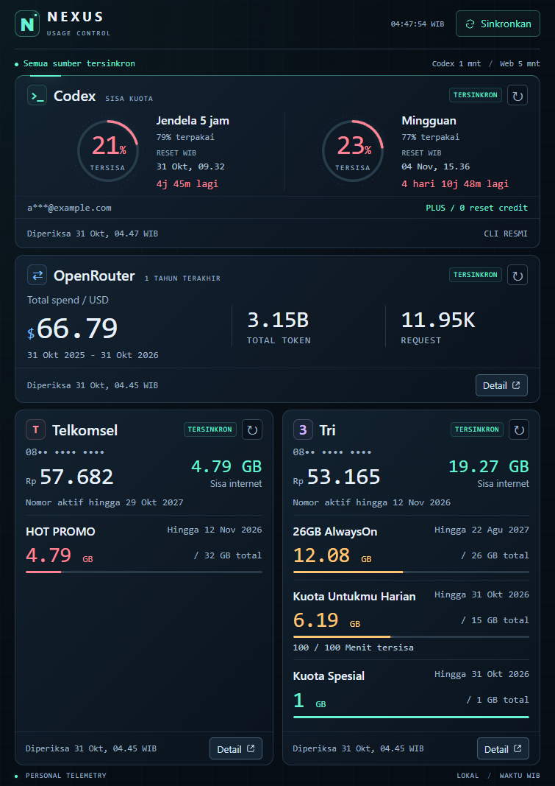

# 🌌 NEXUS Usage Control

**Kuota AI dan internet, cukup satu dashboard lokal.** 🚀

Pantau Codex, OpenRouter, Telkomsel dan Tri dalam tampilan futuristik yang padat, dengan angka besar dan ruang yang efektif untuk setengah layar. Pembaruan berjalan langsung dari server lokal melalui CLI Codex dan HTTP API sumber. ✨



## 👀 Sekilas terlihat

| Sumber | Informasi utama | Pembaruan otomatis |
| --- | --- | --- |
| 🧠 Codex | Sisa kuota 5 jam dan mingguan, waktu reset, akun serta reset credit | 60 detik |
| 💸 OpenRouter | Total spend setahun terakhir, token dan request | 5 menit |
| 🔴 Telkomsel | Pulsa, masa aktif, paket domestik/roaming dan sisa kuota | 5 menit |
| 🟣 Tri | Pulsa, sisa internet, paket aktif dan kuota tambahan | 5 menit |

🖥️ Layout utama dirancang untuk area browser sekitar **755 × 1067 piksel**, termasuk penggunaan pada setengah layar dengan sidebar browser terbuka. Font besar, kartu ringkas dan warna status membantu pemeriksaan cepat. Pada layar lebih sempit, kartu operator ditumpuk agar tetap terbaca.

🔗 Tombol **Detail** membawa Anda langsung ke Activity OpenRouter, Telkomsel atau bima+. Rincian model OpenRouter dapat dilihat di situsnya. Forecast reset komunitas tidak ditampilkan.

## ⚡ Mulai di Windows

Prasyarat: **Node.js 24**, PowerShell, serta **Codex CLI yang sudah login** untuk membaca kuota Codex. Aplikasi memakai modul bawaan Node, sehingga tidak memerlukan `npm install`. 📦

```powershell
git clone https://github.com/fathahnoor/any-usage-tracker.git
cd any-usage-tracker
node server.js --no-open
```

Buka [dashboard lokal](http://127.0.0.1:8792/). Repo privat memerlukan akses GitHub yang sesuai. 🔐

🖱️ Untuk pemakaian harian, klik dua kali **Buka-Usage-Tracker.cmd**. Launcher menjalankan server di latar belakang dan memakai ulang server yang sudah berjalan. Server Codex lama pada port 8791 tidak diperlukan.

## 🔑 Hubungkan akun satu kali

Sesi akun OpenRouter, Telkomsel dan Tri perlu diimpor pada komputer yang menjalankan dashboard:

1. 🌐 Buka BrowserOS neo dan login ke [OpenRouter Activity](https://openrouter.ai/activity), [Telkomsel](https://www.telkomsel.com/user/simpati) dan [bima+](https://bimatri.ioh.co.id/#/account/package). Biarkan ketiga tab tersedia saat impor.
2. 🔌 Pastikan MCP BrowserOS neo aktif. Alamat defaultnya `http://127.0.0.1:9010/mcp`.
3. 📥 Jalankan perintah berikut dari folder proyek:

```powershell
node tools/import-browser-sessions.js
```

✅ Setelah impor berhasil, tutup tab sumber atau BrowserOS bila diinginkan. Sinkronisasi rutin menggunakan HTTP langsung, tanpa membuka halaman sumber dan tanpa jendela khusus yang diminimalkan. Browser tetap dapat digunakan untuk melihat dashboard atau membuka tombol Detail.

🛡️ Sesi disimpan sebagai **data/sessions.dpapi**, terenkripsi menggunakan Windows DPAPI untuk akun Windows pengguna. Cache penggunaan, sesi, log dan berkas privat diabaikan Git. Jangan membagikan folder `data/`. Impor ulang diperlukan saat berpindah akun Windows/komputer atau ketika sesi dicabut maupun kedaluwarsa.

## 🔄 Cara pembaruan bekerja

- 🧠 **Codex** dibaca langsung melalui CLI resmi, dalam server dashboard yang sama.
- 💸 **OpenRouter** memakai analytics akun untuk rentang setahun bergeser, dari awal hari setahun lalu sampai akhir hari ini dalam zona **Asia/Jakarta**. Hasil yang ditandai terpotong ditolak.
- 📶 **Telkomsel dan Tri** dibaca melalui endpoint yang digunakan situs sumber. Paket dengan syarat penggunaan berbeda tetap ditampilkan terpisah.
- ⏱️ Tombol sinkronisasi dapat meminta pembacaan lebih cepat. Jika sumber gagal, data terakhir tetap terlihat dengan status **DATA LAMA**, waktu pemeriksaan dan pesan kesalahan. Kegagalan tidak diubah menjadi angka nol.

Endpoint privat dan mekanisme sesi dapat berubah. Jika login tidak lagi valid, masuk kembali di situs sumber lalu ulangi impor sesi. Kuota khusus mengikuti ketentuan operator. Dashboard mencakup akun Codex, OpenRouter dan kedua operator yang terhubung. 🧭

## 🛠️ Pengembangan dan konfigurasi

```powershell
node --test
node --check server.js
node --check public/app.js
```

| Variabel | Kegunaan | Default |
| --- | --- | --- |
| `USAGE_TRACKER_PORT` | Port server lokal | `8792` |
| `BROWSEROS_MCP_URL` | Endpoint MCP untuk impor sesi | `http://127.0.0.1:9010/mcp` |

🏠 Server mendengarkan di `127.0.0.1`. Agar dashboard terus memperbarui data, biarkan proses server berjalan. Launcher menyembunyikan jendela server. Untuk menghentikannya, cari PID melalui `Get-NetTCPConnection -LocalPort 8792 -State Listen`, lalu hentikan hanya PID tersebut.

## 🔬 Catatan rekayasa

Pembaca API dikembangkan melalui pemeriksaan sumber publik, inspeksi kontrak request dan pengujian langsung pada akun yang diizinkan. Dokumentasi temuan serta batas verifikasinya tersedia di:

- 💸 [OpenRouter](evidence/openrouter/README.md)
- 🔴 [Telkomsel](evidence/telkomsel/findings.md)
- 🟣 [Tri](evidence/tri/findings.md)

NEXUS dikembangkan sebagai dashboard lokal independen. Perubahan API sumber dapat memerlukan penyesuaian adapter. 🧩
